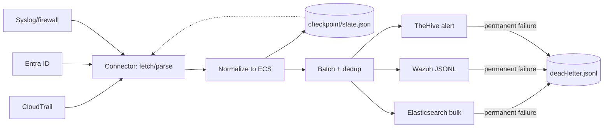

# soc-connector-framework

Fetch security events → parse → normalize to [Elastic Common Schema (ECS)](https://github.com/elastic/ecs) →
forward to SOC destinations. One small, honest framework instead of five one-off scripts.

> **Status: scaffold (milestone M0 of 7).** This commit contains project layout,
> tooling, CI and the package skeleton only. No connector, forwarder or pipeline code
> runs yet — see [Milestones](#milestones) for what lands when. Every claim below about
> what is tested is updated milestone by milestone; nothing is claimed early.

[](LICENSE)


## Why this exists

SOC teams collect the same signal from a dozen sources, and each source arrives with its
own field names, timestamps and failure modes. The usual outcome is a pile of cron jobs:
no shared schema, no deduplication, no retries, no visibility into what silently stopped
flowing.

This framework makes the repeated part once, properly:

- a **connector** that fetches, parses and normalizes one source;
- a **common ECS schema** so a CloudTrail `ConsoleLogin` and a Fortinet `deny` correlate
  in the same query language;
- a **forwarder** that delivers normalized events to a SIEM or case system;
- **checkpointing, retries with backoff, dead-letter files, structured logging and
  metrics** around all of it, so a source can fail without taking the pipeline or the
  evidence with it.

Adding the fourth source should take a day, not a rewrite.

## Planned sources and destinations

| Component | Source / destination | Status |
| --- | --- | --- |
| Connector | AWS CloudTrail (S3 `.json.gz` log files + local fixture directory) | planned — M2 |
| Connector | Microsoft Entra ID sign-in and audit logs (Graph `auditLogs/signIns`, `auditLogs/directoryAudits`) | planned — M3 |
| Connector | Syslog/firewall: UDP/TCP receiver + file tail, Fortinet `key=value` and iptables/UFW formats | planned — M4 |
| Forwarder | Elasticsearch `_bulk`, ECS-formatted documents | planned — M5 |
| Forwarder | Wazuh: JSON-lines file watched by a Wazuh agent `localfile`, optional syslog forward | planned — M5 |
| Forwarder | TheHive: create alert above a severity threshold (experimental) | planned — M5 |
| Sink | `null` sink used by tests and the offline demo | planned — M1 |

Testing policy: **synthetic or anonymized data only.** Real AWS accounts, real Entra
tenants and a live TheHive instance are not part of this repo's test path; anything that
depends on them is marked **"tested with fixtures/mocks only"** here and in the code.

## Architecture (target state)



## Quick start

Nothing runs yet at milestone M0. From M1 the entry point is:

```bash
uv sync --extra dev
uv run soc-connectors --version
```

From M6 the demo will be a single `docker compose up` with a sample-data generator.

## Layout

```
config/           YAML settings (non-secret); secrets come from the environment
docs/             architecture, field mapping, how to add a connector, security
docker/           Dockerfile + compose services for the end-to-end demo
scripts/          developer and demo helpers
src/soc_connectors/
  schema/         pydantic ECS models, severity mapping, redaction
  connectors/     BaseConnector + one module per source
  forwarders/     BaseForwarder + one module per destination
  pipeline/       runner, batching, dispatch
  utils/          checkpoint, retry, dead-letter, pagination, rate limit, time
tests/            unit + integration tests, synthetic fixtures per source
```

## Development

```bash
uv sync --extra dev                                   # create .venv, install + dev tools
uv run --extra dev python -m pre_commit install                # ruff lint, ruff format, mypy, secret scan
uv run --extra dev python -m pytest -m unit                     # fast tests
uv run --extra dev ruff check src tests scripts       # lint
uv run --extra dev ruff format --check src tests      # formatting (Black-compatible)
uv run --extra dev python -m mypy                               # types
uv run --extra dev python -m pytest --cov --cov-fail-under=80   # coverage gate
```

`make -f Makefile help` lists the same targets on Linux/macOS/WSL; on Windows use
`.\scripts\dev_verify.ps1` (or the `uv run` lines above) — `make` is not required.

Tooling notes, because they are decisions a reviewer will ask about:

- **Formatter is `ruff format`, not Black.** Both Black and mypy ship mypyc-compiled
  Windows binaries, and Windows app-control on the development machine refuses them
  (`ImportError: DLL load failed … app-control blocked this file`). `ruff format` is
  style-compatible with Black, so the local and CI formatting gate are the same command
  and actually runnable here. mypy is kept as a gate but installed from source
  (`[tool.uv] no-binary-package = ["mypy"]`, verified as `mypy 2.4.0 (compiled: no)`).
- Type checking and tests are invoked as `python -m mypy` / `python -m pytest` rather
  than the generated `.exe` shims, which app-control also blocks when they load a
  blocked DLL. Same tools, same results, one path that works on every OS.
- **Interpreter coverage:** everything below was verified locally on CPython 3.12.14.
  A uv-downloaded CPython 3.11 was refused by the same app-control policy, so the
  `requires-python = ">=3.11"` claim is checked by the CI matrix rather than on this
  machine — until that pipeline runs green, treat 3.11 as untested rather than confirmed.

## Milestones

| Milestone | Deliverable | Done |
| --- | --- | --- |
| M0 | Repo layout, `pyproject.toml`, ruff (lint + format)/mypy/pytest config, pre-commit, secret scan, CI skeleton | yes |
| M1 | ECS schema, `BaseConnector`/`BaseForwarder`, YAML config, checkpoint, retry+backoff, dead-letter, JSON logging, metrics, pipeline runner, CLI, null sink | not yet |
| M2 | AWS CloudTrail connector (S3 + local fixtures) with moto tests | not yet |
| M3 | Microsoft Entra ID connector (Graph sign-ins and audits) with mocked HTTP | not yet |
| M4 | Syslog receiver + Fortinet and iptables/UFW parsers | not yet |
| M5 | Elasticsearch, Wazuh and TheHive forwarders | not yet |
| M6 | Docker Compose demo + sample data generator + integration test | not yet |
| M7 | Full docs, README sections, badges, coverage report | not yet |

## Verified upstream references

Field names and endpoints in this repo were taken from current official documentation
(retrieved 2026-10-22): [CloudTrail record contents](https://docs.aws.amazon.com/awscloudtrail/latest/userguide/cloudtrail-event-reference-record-contents.html),
[CloudTrail log file layout](https://docs.aws.amazon.com/awscloudtrail/latest/userguide/get-and-view-cloudtrail-log-files.html),
[Graph List signIns](https://learn.microsoft.com/en-us/graph/api/signin-list?view=graph-rest-1.0),
[Graph List directoryAudits](https://learn.microsoft.com/en-us/graph/api/directoryaudit-list?view=graph-rest-1.0),
[TheHive 5 API docs](https://docs.strangebee.com/thehive/api-docs). The full source → ECS
mapping tables land with the docs milestone.

## License

[MIT](LICENSE).
